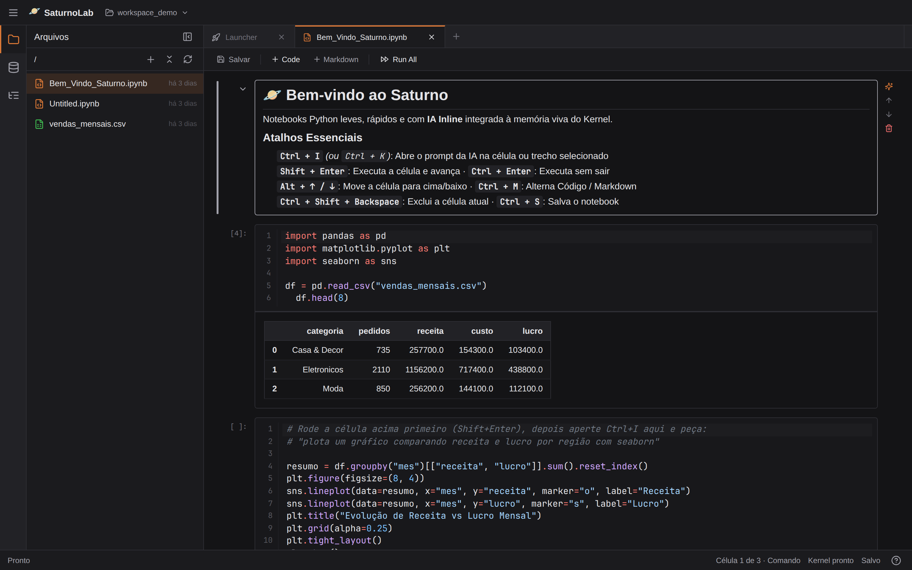
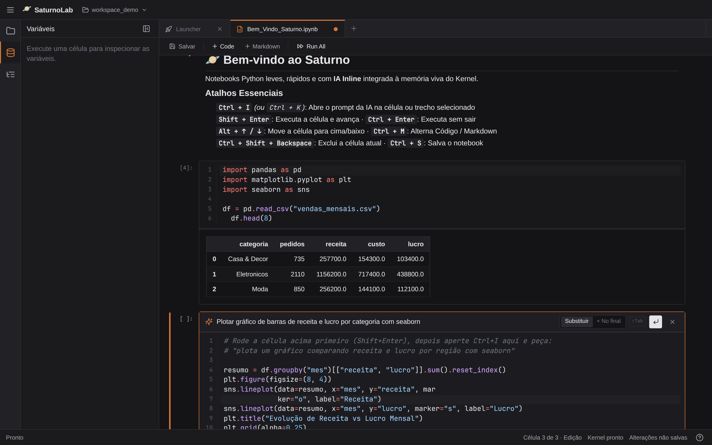
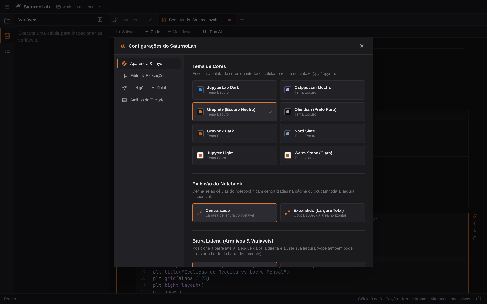
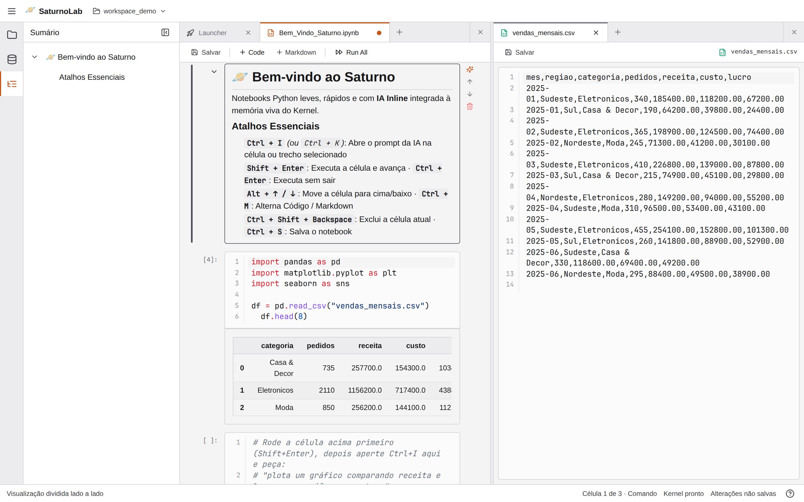

# 🪐 SaturnoLab

**SaturnoLab** (`saturnolab`) is a fast, lightweight, `.ipynb`-compatible Python notebook environment built from the ground up with **Inline AI (`Ctrl+I` / `Ctrl+K`)** connected directly to live Python kernel memory.



---

## Features

### Notebook & Kernel Engine
- **100% `.ipynb` Compatible**: Open, edit, execute, and save standard Jupyter notebooks (`nbformat` v4).
- **Isolated IPython Kernels**: Each notebook runs its own `AsyncKernelManager` (`jupyter_client`) with real-time execution streaming over WebSockets (`/ws`).
- **Rich Cell Outputs**: Supports HTML / pandas `DataFrame` tables, inline `matplotlib`/`seaborn` plots (`PNG`, `JPEG`, `SVG`), `stdout`/`stderr` streams, and ANSI-formatted tracebacks.
- **Automatic Virtualenv Detection**: Automatically detects `.venv`, `venv`, or `.env` in the target project folder, as well as `$VIRTUAL_ENV` and `$CONDA_PREFIX` (even injecting the environment's `site-packages` if `ipykernel` is not installed inside it).

### Inline Cell AI (`Ctrl+I` / `Ctrl+K`)
- **Context-Aware Generation**: Generate or edit Python code and Markdown directly inside any cell or over a selected snippet.
- **Live Kernel Memory Injection**: Automatically inspects the active kernel namespace and injects variable schemas (`DataFrame` shapes, column names and `dtypes`, `Series`, `ndarray` dimensions, collections) along with preceding cells into the prompt.
- **Fast Keyboard Flow**: `Tab` or `Enter` to accept, `Shift+Tab` to toggle **Replace** vs **Append**, `Ctrl+Enter` to accept & execute immediately, and `Esc` to cancel.



### Multi-Provider LLM Support
Configure providers directly in the **AI Settings** modal or via environment variables:
- **Google Gemini API** — `GEMINI_API_KEY` or `GOOGLE_API_KEY` (default: `gemini-2.5-flash`)
- **OpenAI Codex CLI / SDK** — `CODEX_API_KEY` / `OPENAI_API_KEY` or local `~/.codex/auth.json` (with configurable `reasoning_effort`)
- **OpenAI-Compatible APIs** — `OPENAI_API_KEY` + custom `base_url` for OpenAI, local **Ollama**, OpenRouter, LM Studio, etc. (default: `gpt-4.1-mini`)
- **Anthropic Claude API** — `ANTHROPIC_API_KEY` (default: `claude-sonnet-4-5`)

### Workspace & IDE Experience
- **Zero-Bloat Web UI**: Built with React 18, CodeMirror 6, Zustand, Tailwind CSS v4, and FastAPI (~319 KB JS gzipped).
- **Split Editor Panes & Tabs**: Open multiple notebooks and text files side-by-side (`Split Right`) with session persistence.
- **Activity Rail & Resizable Sidebar** (left or right):
  - **File Explorer**: Tree view with file-type icons, drag-and-drop move, copy/cut/paste, rename, batch delete, create `.ipynb`/`.py`/`.md`/`.txt`/folders, and relative modified timestamps.
  - **Live Variable Inspector**: Real-time table of kernel variables with types, shapes, and previews.
  - **Notebook Outline (TOC)**: Auto-generated from Markdown headings (`H1`–`H6`) with click-to-jump and collapsible Markdown sections.
- **Built-in Code & Text Editor**: Edit `.py`, `.md`, `.txt`, `.csv`, `.json`, and other text files with CodeMirror 6 syntax highlighting.
- **8 Built-in Themes & Customizable Layout**: *JupyterLab Dark*, *Catppuccin Mocha*, *Graphite*, *Obsidian*, *Gruvbox Dark*, *Nord Slate*, *Jupyter Light*, and *Warm Stone*, plus centered vs. full-width notebook layout, line numbers toggle, adjustable editor font size (`11`–`22` px), and output display modes (`expanded`, `limited`, `collapsed`).

<p align="center">
  
  
</p>

---

## Installation

Requires **Python >= 3.10**.

```bash
pip install saturnolab

# Optional: include common data science stack (pandas, numpy, matplotlib, seaborn)
pip install "saturnolab[data]"
```

Or install globally as an isolated CLI tool with **`uv`**:

```bash
uv tool install saturnolab
```

---

## Usage

Run `saturnolab` inside **any** project directory, just like `jupyter lab`:

```bash
# Open in the current directory (defaults to http://127.0.0.1:8899)
saturnolab

# Or point to any folder
saturnolab /path/to/project

# Custom port, host, or headless server mode
saturnolab --port 8900 --host 0.0.0.0 --no-browser
```

### CLI Options & Environment Variables

| Option / Env Var | Default | Description |
| --- | --- | --- |
| `directory` | `.` | Project directory to open (`SATURNOLAB_WORKSPACE`) |
| `-p`, `--port` | `8899` | Initial HTTP port; auto-increments if busy (`SATURNOLAB_PORT`) |
| `--host` | `127.0.0.1` | Host interface to bind (`SATURNOLAB_HOST`) |
| `--no-browser` | `false` | Do not open the browser automatically on startup |
| `--reload` | `false` | Enable Uvicorn auto-reload (development) |
| `-v`, `--version` | — | Show version and exit |

User preferences and provider settings are stored at `~/.saturnolab/config.json`.

---

## Keyboard Shortcuts

### Inline AI (inside cell)
| Shortcut | Action |
| --- | --- |
| `Ctrl + I` / `Ctrl + K` | Open Inline AI prompt inside active cell or selection |
| `Shift + Tab` | Toggle between **Replace cell** and **Append to end** |
| `Tab` / `Enter` | Accept generated code |
| `Ctrl + Enter` | Accept generated code and execute cell |
| `Esc` | Cancel / close AI prompt |

### Direct Editing & Execution
| Shortcut | Action |
| --- | --- |
| `Shift + Enter` | Run active cell and advance |
| `Ctrl + Enter` | Run active cell |
| `Alt + Enter` | Run active cell and insert new cell below |
| `Alt + ↑ / ↓` | Move active cell up / down |
| `Ctrl + M` | Toggle cell between Python and Markdown |
| `Ctrl + Shift + Backspace` | Delete active cell |
| `Ctrl + S` | Save active notebook or file |
| `Ctrl + B` | Toggle sidebar |
| `Esc` | Exit to Command Mode |

### Command Mode (after `Esc`)
| Shortcut | Action |
| --- | --- |
| `Enter` | Enter Edit Mode on selected cell |
| `A` / `B` | Insert cell above / below |
| `↑` / `↓` or `K` / `J` | Navigate between cells |
| `M` / `Y` | Convert cell to Markdown / Python |
| `X` / `C` / `V` | Cut / Copy / Paste cell below |
| `Z` | Undo cell deletion |
| `O` | Collapse / expand cell output |
| `D, D` | Delete selected cell |

---

## Development

```bash
# 1. Install Python package in editable mode
uv sync

# 2. Run backend tests
.venv/bin/python -m pytest

# 3. Build frontend assets (output goes to saturnolab/static/)
cd frontend
npm install
npm run build
```

For frontend development with hot reload, run `npm run dev` inside `frontend/` alongside `saturnolab --reload --no-browser`.

---

## License

MIT — see [LICENSE](LICENSE).
